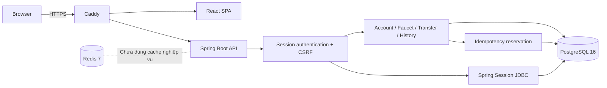
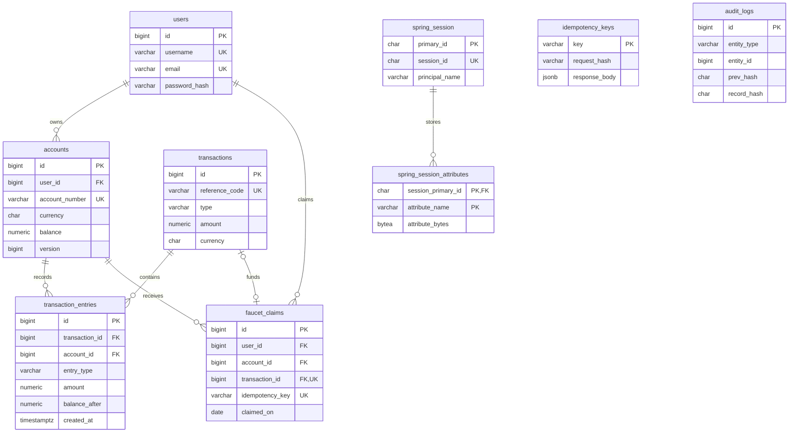

# MiniLedger

MiniLedger là **ứng dụng ví điện tử mô phỏng** để trình diễn double-entry bookkeeping, ACID transaction, pessimistic locking theo thứ tự, idempotency, session authentication và cursor pagination.

> **Demo only:** toàn bộ số dư là dữ liệu giả lập. Dự án không được thiết kế, kiểm định hoặc cấp phép để lưu trữ và xử lý tiền thật.

## Kiến trúc



- Backend: Java 21, Spring Boot 4.1, Spring Security, Spring Session JDBC, JPA, Flyway
- Frontend: React 19, TypeScript, Vite, TanStack Query, React Hook Form
- Data: PostgreSQL 16 là nguồn sự thật; Redis 7 không nằm trong correctness path của money movement
- Edge: Caddy phục vụ SPA, reverse proxy API và TLS tự động

## Tính năng

- Đăng ký, đăng nhập và logout bằng server-side session cookie + CSRF
- API được scope theo user; không thể đọc hoặc chuyển từ account của user khác
- Tạo tối đa 3 account VND cho mỗi demo user
- Demo faucet `100.000 VND` một lần mỗi ngày UTC, có quota và idempotency
- Chuyển tiền bằng account number; lock hai account theo ID tăng dần
- Mỗi money movement ghi đúng hai immutable ledger entries
- Lịch sử keyset/cursor và chi tiết giao dịch
- Giao diện responsive với landing, dashboard, faucet, transfer review và receipt

## Mô hình dữ liệu



Sơ đồ rút gọn các cột, chỉ vẽ quan hệ FK thực từ [V1](src/main/resources/db/migration/V1__init_schema.sql) và [V3](src/main/resources/db/migration/V3__sessions_faucet_and_audit.sql). `reference_code`/idempotency key và `principal_name`/user là liên kết logic, không có FK. Faucet có UNIQUE `(user_id, claimed_on)`. [V4](src/main/resources/db/migration/V4__audit_chain.sql) thêm head/count cho audit hash-chain và trigger chặn TRUNCATE. Money movement ghi audit trong cùng transaction; replay không ghi trùng. [Writer, verifier và giới hạn bảo vệ](docs/audit.md).

## Chạy local

Yêu cầu: JDK 21, Node.js 24 và Docker.

```bash
docker compose up -d
./mvnw spring-boot:run
```

Ở terminal khác:

```bash
cd frontend
npm ci
npm run dev
```

Mở `http://localhost:5173`. Vite proxy `/api` đến backend ở port `8080` nên browser vẫn dùng cùng origin trong development.

## Kiểm thử

```bash
./mvnw clean test
cd frontend
npm run lint
npm test
npm run build
```

Backend integration tests dùng PostgreSQL và Redis thật qua Testcontainers; không dùng database trong `compose.yaml`. Trên Windows PowerShell thay `./mvnw` bằng `.\mvnw.cmd`.

### Browser E2E

Yêu cầu JDK 21, Docker đang chạy, Node 24. Tại `frontend/`:

```bash
npm ci
npx playwright install chromium
npm run build
npm run test:e2e
```

Playwright tự khởi động API Testcontainers tại `127.0.0.1:18080` và Vite preview của bản build tại `127.0.0.1:14173`, đợi readiness rồi chạy Chromium. Cổng đã có server sẽ báo lỗi; mỗi lượt dùng PostgreSQL/Redis mới. Trên PowerShell dùng `npm.cmd`/`npx.cmd` nếu execution policy chặn file `.ps1`.

Ngày 2026-10-09, **4/4 E2E tests pass**, không retry: chuyển tiền giữa hai user và kiểm tra số dư/bút toán; gửi lại sau khi mất phản hồi của giao dịch đã commit; lỗi số tiền/người nhận/thiếu tiền; authentication, logout và quota faucet. [Chi tiết kịch bản và cách đọc report](frontend/e2e/README.md). Đây là kiểm chứng browser + API + database, chưa kiểm tra HTTPS/Caddy hoặc VPS.

### Invariant và bằng chứng cần kiểm tra

| Invariant | Kiểm thử hiện có / điều kiện assert |
| --- | --- |
| Mỗi transfer có đúng hai bút toán cân bằng | `transferMovesMoneyAndWritesExactDoubleEntries`: DEBIT/CREDIT 125.000, số dư 375.000/125.000 |
| Transfer ngược chiều không làm đổi tổng tiền | `orderedPessimisticLocksPreserveBalanceAcrossOpposingTransfers`: 20 operations, không exception, tổng cuối 10.000 |
| Hai request đồng thời cùng key không ghi trùng | `concurrentSameIdempotencyKeyCreatesOneMovementAndReplaysOneResult`: một request mới + một replay, hai entries, số dư 90/10 |
| Giao dịch thất bại rollback cả reservation | `failedTransferRollsBackIdempotencyReservationAndCanRetryWithSameKey`: không lưu transaction/key thất bại, retry được |
| Tạo account đồng thời không vượt quota | `concurrentAccountCreationCannotExceedThreeAccounts`: đã có 2 account, thêm 6 request; đúng một 201, năm `ACCOUNT_LIMIT_REACHED`, tổng cuối 3 |
| Faucet trùng key đồng thời chỉ cấp tiền một lần | `concurrentSameFaucetKeyCreditsOnceAndReplaysEveryOtherRequest`: một 201 + năm 200/replay, cùng transaction ID, hai entries, balance 100.000 |
| Quota faucet dùng chung cho mọi account của user | Hai key khác nhau trên hai account đồng thời: một 201, một `FAUCET_LIMIT_REACHED`; chỉ một claim |
| Key khác payload trả đúng conflict | Cùng key cho hai account hoặc hai user: một 201, một `IDEMPOTENCY_CONFLICT`; trong trường hợp hai user, user thua vẫn claim được bằng key mới |
| Faucet lỗi không tiêu quota/key | Account inactive: rollback claim/key/transaction; mở lại account và retry cùng key thành công |
| Faucet chạy cùng transfer không mất tiền | Một faucet + bốn transfer 10 VND: số dư cuối 100.060 / 40, tổng tiền toàn hệ thống giữ nguyên |

Các test nằm trong [MoneyMovementFlowTests.java](src/test/java/com/LDQuang/mini_ledger/MoneyMovementFlowTests.java) và [ConcurrencyQuotaFlowTests.java](src/test/java/com/LDQuang/mini_ledger/ConcurrencyQuotaFlowTests.java). Chạy lại riêng hai suite:

```powershell
.\mvnw.cmd test "-Dtest=MoneyMovementFlowTests,ConcurrencyQuotaFlowTests"
```

Ngày 2026-10-09, sau bản sửa Priority 3, `mvnw.cmd test` chạy **27 tests, 0 failures/errors/skipped**, gồm 9 tests trong `MoneyMovementFlowTests` và 8 tests trong `ConcurrencyQuotaFlowTests`. Chromium E2E cũng đã chạy lại và pass **4/4**, không retry. Frontend lint, 1 Vitest test và build đã pass ở Priority 2. Giá trị balance trong bảng là **assertions trong mã**, không phải console log hoặc số liệu hiệu năng.

Lock account theo ID tăng dần nhằm tránh deadlock giữa các transfer dùng cùng quy tắc. Double-entry do service ghi trong transaction; schema hiện tại không tự cưỡng chế tổng DEBIT/CREDIT theo từng transaction. Trigger append-only chặn UPDATE/DELETE thông thường, không bảo vệ trước mọi thao tác của DB administrator.

Tạo account và claim faucet lấy pessimistic lock trên dòng `users` trước khi đọc quota, giữ lock đến cuối transaction. Vì vậy các thao tác quota của cùng user được tuần tự hóa cả khi ứng dụng có nhiều instance; giới hạn 3 account vẫn là invariant của service, không áp dụng cho thao tác SQL trực tiếp bỏ qua service. Faucet xử lý global idempotency key trước khi lưu claim, để collision giữa user trả `IDEMPOTENCY_CONFLICT`; claim, entries, balance và key cùng commit/rollback. Ownership/currency được đọc bằng scalar query để không giữ entity account với balance cũ trước khi khóa account.

Lượt kiểm tra trước bản sửa Priority 3 đã tái hiện 5/8 test lỗi: vượt quota account, faucet trùng key bị 409 thay vì replay và xung đột quota/key bị trả lỗi constraint chung. Sau bản sửa, suite concurrency mới pass 8/8; các test đồng thời có barrier khởi chạy, timeout và đóng executor trong `finally`.

## Benchmark index và pagination

Có [harness và hướng dẫn tái lập](benchmarks/README.md) với PostgreSQL riêng, 100.000 entries, EXPLAIN trước/sau index và [k6 script](benchmarks/history-pagination.js) so sánh trang 1/trang 1.000. Harness lấy SQL trực tiếp từ repository, kiểm tra OFFSET/keyset trả cùng IDs và không sửa migration/query production.

| Thí nghiệm | OFFSET / không index | Keyset / có index |
| --- | --- | --- |
| Query đơn, median SQL execution (5 lượt) | 10,403 ms; Seq Scan; 1.011 buffer hits | 0,018 ms; Index Scan; 5 buffer hits |
| Trang 1, HTTP p50 / p95 | 71,44 / 84,58 ms | 70,95 / 87,70 ms |
| Trang 1.000, HTTP p50 / p95 | 77,02 / 88,13 ms | 48,54 / 56,53 ms |

Đo ngày 2026-10-09 với k6 1.0.0, 2 VUs, 50 mẫu hợp lệ/case, error rate 0; mọi kiểm tra thứ tự 21 IDs và thresholds đều pass. `HistoryBenchmarkIT` pass 2/2. [Raw EXPLAIN, k6 summary và metadata](benchmarks/results/2026-10-09-local/README.md) đã được lưu cùng hash mã nguồn. Keyset trang sâu có p50 thấp hơn khoảng 37% trong lần chạy này; hai cách ở trang đầu có kết quả gần nhau. Full JOIN query vẫn có Seq Scan và chi phí đáng kể, nên không suy tốc độ query đơn có index thành tốc độ toàn API. Đây là một lần đo warm-cache SQL-over-HTTP trên fixture local, không phải benchmark end-to-end có authentication hay bằng chứng năng lực production.

## API

Import [Postman collection](postman/MiniLedger.postman_collection.json) cùng [environment local](postman/MiniLedger.local.postman_environment.json); xem [hướng dẫn chạy demo](postman/README.md). Collection dùng cookie jar + CSRF và chuyển session rõ ràng giữa hai user. Ngày 2026-10-09, Newman 6.2.1 chạy hai lượt liên tiếp trên API Testcontainers riêng: mỗi lượt 31 bước, 31 assertions, 0 failures. [Bằng chứng từng assertion](postman/results/2026-10-09-local/README.md) không chứa cookie/token; chạy lại bằng `node postman/verify.cjs` theo hướng dẫn.

OpenAPI JSON có ở `GET /v3/api-docs` khi backend chạy. Các route chính:

| Luồng | Endpoint |
| --- | --- |
| CSRF / register / login / logout / current user | `/api/v1/auth/*` |
| List, create, read account | `/api/v1/accounts` |
| Resolve người nhận | `/api/v1/accounts/by-number/{number}` |
| Faucet status / claim | `/api/v1/faucet/status`, `/api/v1/faucet/claims` |
| Transfer | `POST /api/v1/transfers` |
| Cursor history | `GET /api/v1/accounts/{id}/transactions` |
| Transaction receipt | `GET /api/v1/transactions/{id}` |

Faucet và transfer yêu cầu header `Idempotency-Key` (1–64 ký tự). Cùng key + cùng payload replay kết quả; cùng key + payload khác trả `409 IDEMPOTENCY_CONFLICT`.

## Deployment một VPS

Xem [hướng dẫn VPS, diễn tập local và xử lý lỗi](docs/operations.md). Copy [.env.example](.env.example), tạo secret và cài operations bundle cùng commit với image trước khi deploy bằng digest:

```bash
export BACKEND_IMAGE='ghcr.io/OWNER/mini-ledger-backend@sha256:DIGEST'
export FRONTEND_IMAGE='ghcr.io/OWNER/mini-ledger-frontend@sha256:DIGEST'
sh scripts/deploy.sh
unset BACKEND_IMAGE FRONTEND_IMAGE
```

Production topology chỉ publish `80/443`; Postgres/Redis nằm trên internal network. Caddy tự lấy certificate và phục vụ SPA + API cùng origin. Hãy bật firewall chỉ cho SSH, HTTP và HTTPS.

### Backup và restore

```bash
sh scripts/backup.sh
RESTORE_DB=mini_ledger_restore CONFIRM_RESTORE=yes sh scripts/restore.sh backups/FILE.dump.gz
ROLLBACK_COMPATIBLE=yes sh scripts/rollback.sh
```

- Gửi backup đã mã hóa đến object storage ngoài VPS.
- Lập lịch hằng ngày và cảnh báo khi script thất bại.
- Thử restore định kỳ vào một database tách biệt; snapshot volume không thay thế restore drill.

### CI/CD

- `test.yml`: backend integration tests, frontend lint/test/build, Chromium E2E với Testcontainers rồi mới build cả hai image. E2E chặn `.only` và fail cả khi test flaky; HTML report cùng failure traces/screenshots được giữ 7 ngày trong artifact `playwright-report`.
- `deploy.yml`: manual dispatch với full commit SHA đã pass CI, publish image và deploy bằng digest; yêu cầu operations bundle cùng revision. Cần cấu hình required reviewers của GitHub Environment `production` để có approval.
- Deploy backup trước migration và kiểm tra readiness qua Caddy. Rollback dùng image ID trước, yêu cầu tương thích schema và audit writer v1; không tự rollback schema.
- `sh scripts/drill.sh`: diễn tập Docker project riêng, restore vào DB clone, kiểm tra fingerprint/audit, từ chối backup hỏng và rollback image. Local HTTP không kiểm chứng HTTPS hoặc VPS.

### Audit và regression

Ngày 2026-10-10, `mvnw.cmd test` pass **33 tests, 0 failures/errors/skipped**, gồm 6 audit tests: writer/replay, rollback khi ghi audit lỗi, concurrent writer, append-only, sửa nội dung/liên kết và xóa phần đuôi. Chromium E2E pass **4/4**, không retry. Diễn tập Docker deploy → backup → restore → rollback pass; 4 lượt Postman đều có 31 assertions thành công, fingerprint dữ liệu và audit chain khớp sau restore/rollback. [Bằng chứng local](operations/results/2026-10-10-local/README.md).

[Chi tiết audit](docs/audit.md): không backfill giao dịch trước V4; DBA có thể viết lại chain/head, nên cần checkpoint hash độc lập. Hai image trong diễn tập dùng cùng mã và khác nhãn build; kết quả kiểm chứng cơ chế rollback, chưa chứng minh tương thích giữa các release/schema khác nhau hoặc vận hành VPS/HTTPS.

## Production checklist

- HTTPS + cookie `Secure/HttpOnly/SameSite=Lax`; không expose DB/Redis
- Secret dài, ngẫu nhiên và được rotate; GitHub Environment secrets không nằm trong repo
- Backup ngoài VPS và restore drill đã pass
- Theo dõi readiness, 5xx, disk, DB pool, failed login, faucet rejects và backup failures
- Không log password, cookie/session, CSRF hoặc payload nhạy cảm
- Chạy load test và đối soát tổng balance + exact-two-entries sau tải
- Banner “demo only” luôn hiển thị; không tích hợp tiền thật nếu chưa có threat model, compliance và security audit độc lập

Chi tiết về thiết kế sổ cái và trade-off nằm trong [ledger.md](ledger.md).
